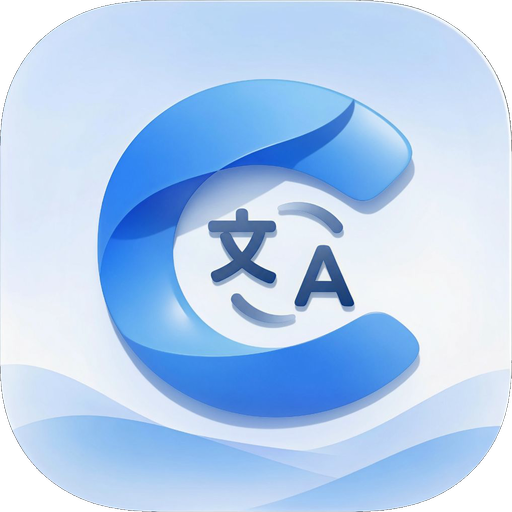

# Cobalt

  

<strong>Локализация и адаптация приложений ColorOS</strong>

Cobalt – проект, направленный на локализацию интерфейса приложений ColorOS и его адаптацию для комфортного использования на русском языке.

Проект объединяет инструменты перевода, настройки элементов интерфейса и управления совместимостью. Это позволяет не только переводить системные приложения, но и устранять отдельные недостатки, возникающие при отображении переведённого текста.

## О проекте

Локализация ColorOS не ограничивается заменой строк. В некоторых приложениях текст встроен непосредственно в изображения, отдельные элементы интерфейса не предусматривают размещение более длинных надписей, а переведённые пункты меню могут отображаться некорректно.

Cobalt решает эти задачи с помощью отдельных профилей, предназначенных для конкретных приложений.

Изменения применяются непосредственно во время работы приложения. Исходные APK-файлы остаются нетронутыми.

## Возможности

### Локализация интерфейса

Перевод системных надписей, пунктов меню, заголовков, диалоговых окон и других текстовых элементов. Замена выполняется во время работы приложения без изменения его исходных файлов.

### Адаптация интерфейса

Корректировка отдельных элементов, которые могут отображаться некорректно после перевода. В зависимости от профиля это может включать изменение отступов, размеров элементов и отдельных ресурсов.

### Профили совместимости

Для каждого приложения предусмотрен отдельный профиль. Он содержит сведения о доступных изменениях и условиях их применения.

### Диагностика

Встроенные инструменты позволяют проверить состояние root-доступа, LSPosed и Cobalt Platform. Для поиска и устранения неполадок предусмотрены системные журналы с возможностью их экспорта.

## Архитектура

Cobalt построен на основе нескольких компонентов, каждый из которых выполняет свою задачу.

- **Cobalt App** – основное приложение, объединяющее интерфейс управления и LSPosed-модуль. Оно отвечает за управление словарями, профилями, обновлениями и журналами, а также выполняет перевод непосредственно внутри процессов выбранных приложений.
- **Cobalt Platform** – системный компонент, обеспечивающий выполнение необходимых операций с root-доступом, проверку состояния и работу с журналами.
- **Profiles** – набор профилей, определяющих особенности локализации и адаптации отдельных приложений.

Такое разделение позволяет независимо обновлять локализацию, профили и системные компоненты проекта.

## Совместимость

Подготовлены отдельные каталоги анализа для двух пакетов Theme Store:

- `com.heytap.themestore` – версия `17.22.1`;
- `com.oplus.themestore` – версия `EXP_17.11.20`.

Это разные приложения. Их профили, словари и версии хранятся раздельно. Если для приложения и его версии нет точного профиля, Cobalt не применяет к нему никаких изменений.

Следует учитывать, что некоторые элементы, включая содержимое WebView, текст внутри изображений и нестандартные компоненты интерфейса, могут оставаться непереведёнными.

## Безопасность и конфиденциальность

Cobalt не вносит изменений непосредственно в исходные APK-файлы. Применение профилей осуществляется с учётом предусмотренных механизмов проверки установленных приложений.

Cobalt Platform не содержит готовых APK-файлов и не загружает сторонние приложения из сети. Его функции ограничены необходимыми системными операциями, проверкой установленных пакетов, диагностикой и откатом изменений.

Основные словари и профили загружаются из репозитория Cobalt и кэшируются на устройстве. Благодаря этому они остаются доступными для работы без подключения к сети.

Пользовательские переводы хранятся отдельно, непосредственно на устройстве, и не публикуются в репозитории автоматически.

Системные журналы не содержат пользовательских переводов. Период их хранения и параметры очистки настраиваются непосредственно в приложении.

При отсутствии Cobalt Platform часть системных операций и диагностических возможностей недоступна. При этом перевод, выполняемый через встроенный LSPosed-модуль, может продолжать работать.

## Структура проекта

| Каталог | Назначение |
|---|---|
| `app/` | Основное приложение Cobalt, включая LSPosed-модуль |
| `platform/` | Системный компонент Cobalt Platform |
| `profiles/` | Профили локализации и адаптации |
| `dictionaries/` | Файлы локализации |
| `payloads/` | Ресурсы для Cobalt Platform |
| `manifests/` | Каталог и описания обновлений |
| `schemas/` | Схемы и форматы данных |
| `assets/` | Графические материалы |
| `docs/` | Документация проекта |

## Как устроен проект

| Компонент | Что делает |
|---|---|
| **Cobalt App** | интерфейс, каталог, переводы, обновления |
| **Cobalt Platform** | root-модуль: обнаружение приложений, копирование APK, подмена и откат |
| **LSPosed-часть** | подмена текста в процессе приложения, без изменения файлов |

## Каталог переводов

Каталог живёт в репозитории отдельно от APK, поэтому переводы обновляются без пересборки:

- `manifests/catalog.json` — что поддерживается, какие переводы есть, контрольные суммы;
- `dictionaries/<package>/<version>/<language>.json` — строки для подмены в рантайме;
- `payloads/<package>/<version>/resources.arsc` — изменённые ресурсы для платформы;
- `schemas/` — форматы.

Приложение скачивает каталог, сверяет установленные пакеты **на устройстве** и
показывает только то, что реально установлено. Список приложений никуда не передаётся.

## Версии приложений

Привязки к конкретной версии нет. Если вашей версии нет в списке проверенных, Cobalt
показывает предупреждение и продолжает работать — перевод для соседней версии обычно
лучше, чем никакого. Отдельно сообщается, если часть строк в этой версии отсутствует.

## Безопасность

- Платформа исполняет **только заранее определённые операции**. Данные с сервера не
  становятся командами: рецепт проверяется по белым спискам (тип операции, имя записи
  в APK, домен источника, формат SHA-256).
- `mount` принимает файл только из хранилища приложения, кэша платформы или
  `/data/local/tmp`, и только настоящий zip-контейнер.
- Канал «платформа → приложение» закрыт токеном: провайдер читается только с токеном,
  который приложение передало через `configure`, и защищён `android.permission.DUMP`.
- Перезагрузка, обновление приложения и удаление модуля снимают подмену; откат — одна команда.

## Состояние

Первая бета: каталог, загрузка переводов, обновления, платформа с запросом данных.
Сканирование ресурсов и автоматическая модерация строк — в разработке.

## Обновления

Актуальные сборки публикуются в разделе [Releases](../../releases).

Словари и профили распространяются отдельно от основного приложения. Это позволяет обновлять локализацию и настройки приложений независимо от выпуска новых сборок Cobalt App.

## Сообщество и поддержка

Присоединяйтесь к [ELQAREN](https://t.me/elqaren) – сообществу, объединяющему пользователей и энтузиастов. Здесь можно получить помощь по Cobalt и другим техническим вопросам, обсудить устройства и программное обеспечение, поделиться опытом или обратиться непосредственно к создателю проекта.

## Авторство

**Phontex**

[GitHub](https://github.com/phontex)

## Лицензия

Собственный исходный код проекта распространяется под лицензией Apache-2.0. Сторонние компоненты и зависимости сохраняют условия своих исходных лицензий.
