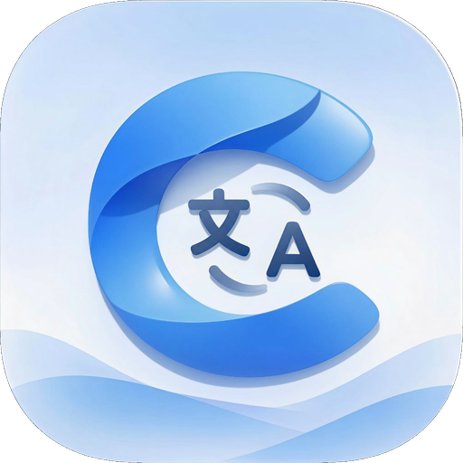

# Cobalt

<p align="center">
  
</p>

<h1 align="center">ColorOS на вашем языке</h1>

<p align="center">Перевод интерфейса и настройка приложений ColorOS.</p>

## О проекте

Cobalt переводит интерфейс приложений ColorOS на русский язык и исправляет то, что не решается одним переводом: подписи, встроенные в изображения, обрезанный текст и слишком тесные отступы для более длинных слов.

Приложения не переписываются целиком. Изменения применяются точечно, по заранее подготовленному профилю для конкретной версии приложения.

## Что делает Cobalt

**Перевод текста.** Подписи, пункты меню, заголовки и диалоги заменяются во время работы приложения. Оригинальный APK при этом не изменяется.

**Настройка интерфейса.** Если после перевода текст не помещается, обрезается или остаётся на изображении, профиль может изменить отступы, размеры элементов и отдельные ресурсы.

**Профили.** Для каждого приложения и каждой версии готовится отдельный профиль. В нём указано, какие функции включены и что именно разрешено менять.

**Диагностика.** Приложение показывает состояние root-доступа, LSPosed и Cobalt Platform, ведёт журнал и позволяет сохранить его для разбора.

## Состав проекта

- **Cobalt App** – интерфейс, словари, профили, журналы и обновления.
- **LSPosed-компонент** – перевод внутри процесса приложения.
- **Cobalt Platform** – системный компонент для root-операций, проверки состояния и журналов.
- **Профили** – данные совместимости для конкретных пакетов и версий.

## Совместимость

Сейчас профиль существует только для Theme Store (`com.heytap.themestore`) версии `17.11.18`. Для остальных приложений профилей нет, поэтому Cobalt их не изменяет.

Работа проверяется на конкретной версии приложения и прошивки. После обновления приложения профиль может перестать подходить. Текст внутри WebView, изображений и нестандартных элементов интерфейса переводится не всегда.

## Безопасность

Оригинальные APK не изменяются. Изменения применяются только при совпадении пакета, версии, подписи и контрольной суммы с профилем. Если хотя бы одно значение отличается, приложение остаётся без изменений.

Cobalt Platform не содержит готовых APK и не загружает файлы из сети. Модуль выполняет ограниченный набор задач: проверку состояния, поиск установленного пакета, работу с журналами и откат.

Словарь хранится на устройстве. Журналы не включают пользовательские переводы; срок хранения и очистка настраиваются в приложении.

Без Cobalt Platform недоступны системные операции и часть диагностики. Перевод через LSPosed при этом может продолжать работать.

## Структура репозитория

```text
app/          Cobalt App
platform/     Cobalt Platform
profiles/     профили приложений
dictionaries/ словари
manifests/    сведения об обновлениях
schemas/      форматы данных
assets/       логотип
docs/         описание проекта
```

## Обновления

Сборки публикуются в разделе Releases. Словари и профили обновляются отдельно от приложения, поэтому для изменения перевода не требуется пересобирать APK.

## Автор

Phontex – [GitHub](https://github.com/phontex) · [Telegram](https://t.me/elqaren)

## Лицензия

Apache-2.0 для собственного кода. Сторонние компоненты сохраняют свои исходные лицензии.
